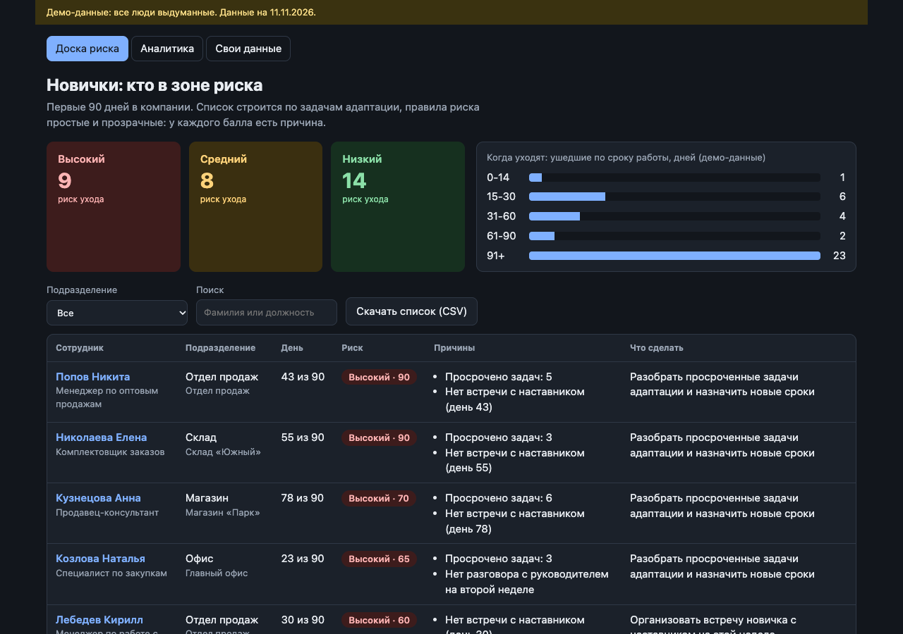
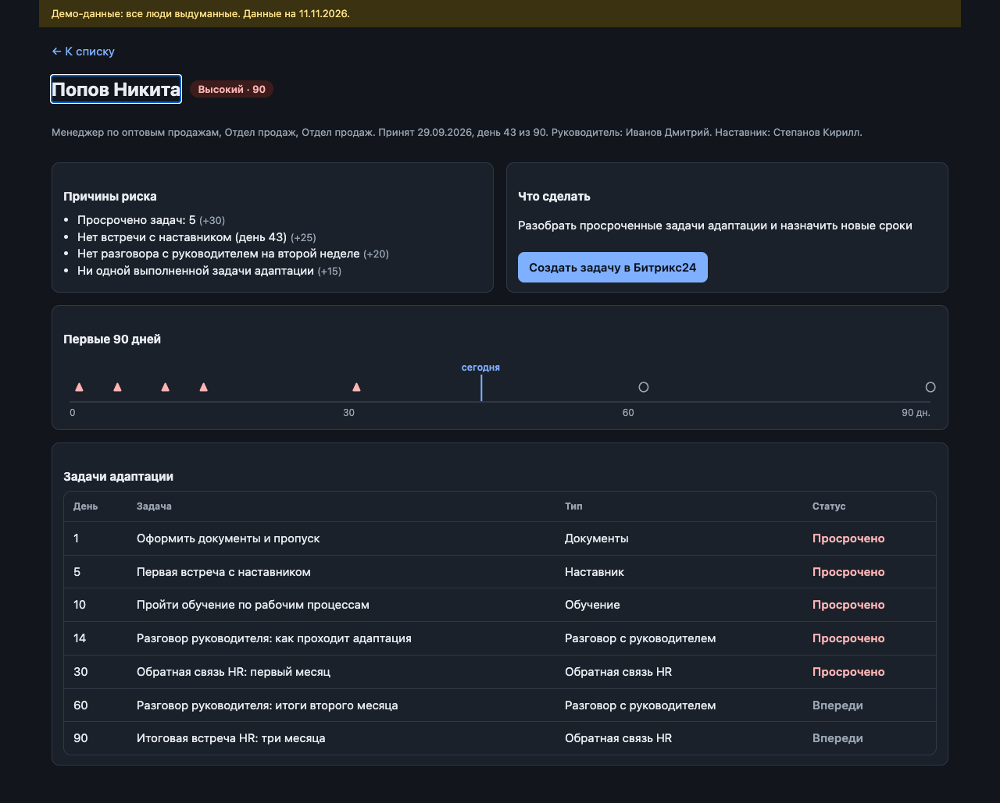
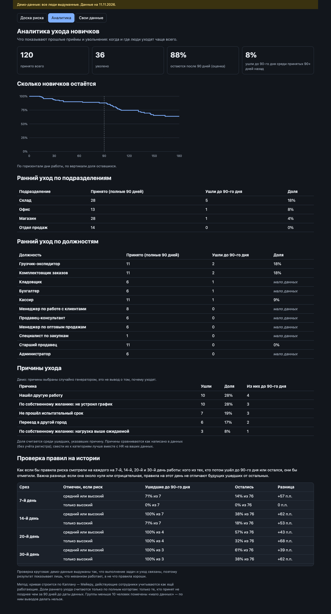

# Onboarding Risk Board

**Live demo:** https://eugenehil.github.io/onboarding-risk-board/ (synthetic data) · **Code:** https://github.com/EugeneHil/onboarding-risk-board

A small static web app for HR and line managers of a sports-goods wholesale and retail company (~400 people, 100+ hires a year, onboarding and offboarding run as Bitrix24 tasks). About one in three leavers quits before the third month, so the app focuses on the first 90 days: **who among the newcomers needs a call today, and why**.

The report for the test task is in [REPORT.md](REPORT.md) (Russian and English).

## Screenshots (synthetic demo data)



| Card | Analytics | Phone |
| --- | --- | --- |
|  |  |  |

## Assumption (please read)

The company says hiring and dismissal run as Bitrix24 tasks. The risk rules below additionally assume that **an onboarding task chain exists** (mentor meeting, manager check-ins, ...). That is **not confirmed**. If it does not exist, only hire and leave dates are certain; see [docs/data-contract.md](docs/data-contract.md) for the minimal data this needs.

## What it does

- **Board.** Active newcomers in their first 90 days, riskiest first. Summary tiles (click to filter by risk level), a chart of when people leave, department filter, search by name or position. "Скачать список (CSV)" downloads what is currently shown (UTF-8 with BOM, `;`-separated, all reasons per person; text starting with `=`, `+`, `-` or `@` is neutralised against spreadsheet formulas). The board also has a print layout (light palette, no controls).
- **Card.** Risk score with the reasons behind it ("Почему +25?" opens the rule and its numbers, taken from `RULES`), the recommended next action, a 0 to 90 day timeline of onboarding tasks and the task table.
- **Analytics.** `#/analytics`: Kaplan-Meier curve of how many newcomers stay, early-exit rate (left within 90 days) by department and by position. Only hires made at least 90 days before the data date count, groups under 10 hires are labelled "мало данных".
- **Rules backtest.** On the analytics screen: replays the risk rules as of day 7, 14, 20 and 30 of each person, at two thresholds (medium or high / high only), and shows how many early leavers vs stayers they would have flagged, with the difference. On the demo this is circular (the generator links task completion and leaving) and is labelled so; on your data it is a first check of the hypotheses.
- **Your own data.** `#/import`: load a people table (CSV with `;`, `,` or tab, or JSON) and optionally an onboarding-tasks table; Russian or English headers, `DD.MM.YYYY` dates. Bad rows are skipped and reported with their row number. Files are processed in the browser only. Without a tasks file there is no rule-based risk (it would invent "no mentor meeting" for everyone), so the board shows newcomers ranked by their department's history instead. Templates: `public/samples/`; columns: [docs/data-contract.md](docs/data-contract.md).
- **Bitrix24 task.** A button builds the `tasks.task.add` call for a check-in with the newcomer. It is only displayed (and can be copied), never sent: there is no Bitrix24 integration.

## Risk rules

The rules are plain and every point has a visible reason. All numbers live in `RULES` in `src/domain/rules.ts`. They are hypotheses, **not validated on real data**.

| Rule | Fires when | Points |
|---|---|---|
| Overdue tasks | an open onboarding task is past its due day | 10 per task, max 30 |
| No mentor meeting | after day 7 the mentor meeting is not done | 25 |
| No two-week check-in | after day 16 the manager check-in due by day 14 is not done | 20 |
| Stalled | tasks are overdue and nothing was completed in the last 14 days | 15 |

One missed task can score twice on purpose: an open mentor meeting or two-week check-in counts as overdue (10) and also fires its own rule (25 or 20), and both lines are shown. "Stalled" counts idle days from the hire date when nothing was ever completed.

Level: **high** from 50 points, **medium** from 25, otherwise **low**. There is no machine-learning model by design: with invented data it would only imitate prediction.

## Data

Everything is synthetic. `src/data/generate.ts` produces 120 fictional employees (seeded, deterministic) with Bitrix24-style onboarding tasks. A hidden "engagement" value drives both task completion and leaving, and the parameters are tuned so that about a third of leavers quit within 90 days, as the company described. This makes the demo plausible, **not evidence** about real people. Names are random combinations of common first names and surnames; no real person is represented. The demo "today" is fixed at 2026-11-11. The demo seed (22) was picked from seeds 1 to 40 for a balanced board (31 newcomers: 9 high, 8 medium, 14 low risk; 13 of 36 leavers left within 90 days); other seeds give shares between about 0.15 and 0.47.

## Run

```sh
npm install
npm run dev        # development server
npm test           # unit and UI tests (Vitest, jsdom)
npm run build      # type-check and build to dist/
npm run preview    # serve the production build
npm run check:browser   # 69 end-to-end and axe-core accessibility checks in a real Chrome against the preview (needs Chrome; CHROME_PATH, BASE_URL optional)
```

Node 20 or newer. Deployment to GitHub Pages is in `.github/workflows/pages.yml` (tests, build, publish on push to `main`); the app uses relative asset paths and hash routing, so it works under a repository sub-path.

## Layout

```
src/domain/   dates, risk rules, board, stats, attrition analytics, backtest, Bitrix24 payload (pure functions)
src/import/   CSV/JSON table parser and row mapping with per-row issues
src/data/     seeded generator and the demo dataset
src/ui/       React screens: board, card, timeline, modal, analytics, import
docs/superpowers/plans/   the implementation plan this was built from
```

## Limits and next steps

- No real Bitrix24 integration (needs a webhook or an app and access to the real task data).
- Rule weights and thresholds are untested against real attrition; they need to be checked against the company's own history of leavers.
- No authentication or roles, no notifications.
- Accessibility is checked automatically with axe-core (0 violations on every screen in Chrome's default dark scheme, plus the board, analytics and import in the light scheme, desktop and phone width), which finds only part of the problems. Not tested in Safari or Firefox or with real screen readers.
- The analytics on the demo is synthetic and says nothing about the company; it needs the company's own export. The import was only tried on generated files, not on a real Bitrix24 export.
